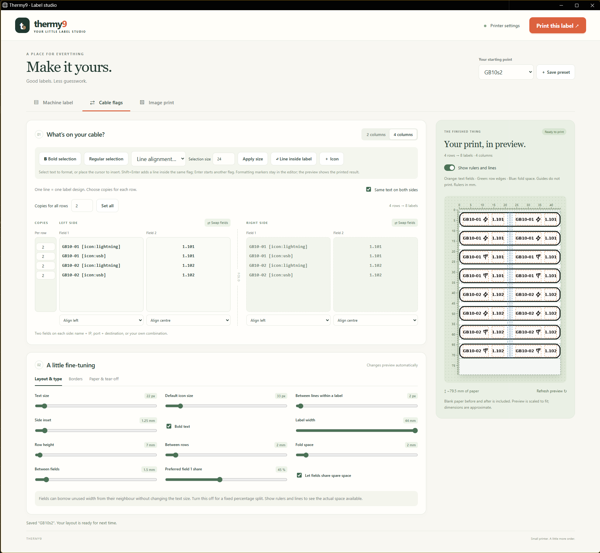

# Thermy9

A small Windows label studio for the **PAPERANG P2S**. Make machine labels,
fold-over cable flags and image prints, with a live preview before you print.

**[Download for Windows](https://github.com/josecartro/Thermy9/releases/download/v1.0.1/Thermy9_1.0.1_x64-setup.exe)**
· [Release notes and source](https://github.com/josecartro/Thermy9/releases/tag/v1.0.1)

Windows 10/11, 64-bit, with Bluetooth. This is an **unsigned preview release**;
testing on another PC is still pending. If Windows blocks it, keep security
enabled and use your normal software approval process.

## What you can make

- **Machine labels:** names, equipment details and multiple lines of text.
- **Cable flags:** 2 or 4 columns, with one or two fields on each side of the fold.
  Mirror the text or edit each side separately, swap fields and set alignment.
- **Image prints:** turn your own images into black-and-white prints.

Adjust text and icon sizes, borders, spacing and paper feed using sliders.
Preview rulers and guides help you see where everything fits. Choose copies per
row to print a batch, and save your favourite layouts as presets. Includes 80
monochrome icons for hardware, networking and more.

## Your first print

1. Run the installer and open **Thermy9** from Start.
2. Turn on Bluetooth and your printer. Open **Printer settings → Find printer**.
3. Choose **Machine label**, **Cable flags** or **Image print** and add your content.
4. Adjust the layout, check the preview and print.

No Python, Docker or Rust setup is needed to use the app. Installation may download
Microsoft WebView2 if it is missing; afterward the app works offline.

Use continuous paper. Other printer models and pre-cut label gap sensing are not
currently supported. To move your layouts to another PC, use **Save preset →
Export presets**, then import them there.

## Build or contribute

Built with Rust, Tauri and a web editor. See [setup and build instructions](docs/installing.md)
to run from source. Found a bug? [Open an issue](https://github.com/josecartro/Thermy9/issues)
with your Windows version, printer model and what happened.

[Release checks](docs/release-checks.md) · [Privacy checks](docs/privacy-check.md)

Licensed under [GPLv3](LICENSE). Not affiliated with Paperang.
[Third-party notices](NOTICE).
